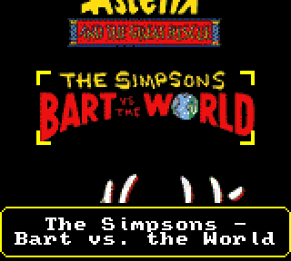

# Game Gear flash cart wheel browser

A scrolling **wheel of game art** for the Game Gear flash cart menu, in the
style of an emulator front end. It is a patch for **EverDrive GG OS v9**
(`os-v9.mso`, by Krikzz), as used by EverDrive GG-compatible carts such as
the **Flash Gear Pro** (board "Flash Gear Pro ©2020"), which is the cart it
was developed and tested on.

[](https://paypal.me/ggflashcart)



---

> [!WARNING]
> ## Flashing modified firmware can brick your flash cart
>
> Installing this replaces the cart's operating system in its flash memory.
> If the update is interrupted (power loss, flat batteries, a loose
> cartridge), if the file is damaged, or if your cart differs from the one
> this was tested on, **the cart may stop booting** and need recovery, or
> may be left unusable.
>
> * **You use this entirely at your own risk.** It is provided as is, with
>   no warranty (see [LICENSE](LICENSE)). Nobody involved is responsible for
>   damage to your cart, your Game Gear, your SD card or your saves.
> * This is an unofficial project. It is **not made, supported or endorsed
>   by Krikzz** or by any cart manufacturer. Don't ask them for help with it.
> * Before you start, read [Install safely](#install-safely). Make sure you
>   know how to start your cart's backup OS, back up your `/SAVE` folder,
>   and use fresh batteries or the mains adapter.
> * The firmware has only been tested on one Flash Gear Pro. Other carts
>   running OS v9 may behave differently.

---

## What it does

* **Wheel view**: the cart starts in a vertical wheel of art, three games
  on screen. The centre game is framed, with its name in a banner along the
  bottom of the screen.
  * Up/Down scrolls smoothly and wraps round at the ends. Hold the button
    to speed up to about 10 games a second; the art comes back when you let
    go.
  * 1 opens a game's file menu or a folder, 2 goes back.
* **Bigger art**: pictures are up to 144×56 pixels. Wide logos from wheel
  packs work best.
* **Tidy names**: `Simpsons, The - Bart vs. the World (World).gg` shows as
  **The Simpsons - Bart vs. the World**. Text in brackets and the extension
  are dropped, ", The / A / An" moves to the front, and long names wrap
  onto up to three lines.
* **Only games in the wheel**: system folders (THUMBS, SAVE…) and non-game
  files (.mso, .srm, .txt…) are left out. List View still shows
  everything.
* **Favourites**: add a game from its file menu. A *Favourites* entry then
  appears at the top level of the card, next to your folders, with its own
  wheel.
* **Quick Menu** (Start): Wheel View, List View, Jump To Letter (A-Z),
  Recently Played (last 8), Favourites (up to 16).
* **Clearer font**: unscii-8-alt.

Changes to the OS that make room:

* The Hex View is gone (the save-file menu item and opening `.txt` files).
* USB loading is gone (the Flash Gear Pro has no USB port).
* The *About* screen is gone from the Main Menu. Press 2 at the top level
  of the card for Start Game and Device Info.

## What's in this repository

| Path | What |
|---|---|
| `patch/os-v9-wheel.ips` | the patch: original `os-v9.mso` → wheel firmware |
| `patch/apply_patch.py` | applies it, with checksum checks before and after |
| `src/` | the patch's source (Z80, [sjasmplus](https://github.com/z00m128/sjasmplus)) |
| `build.py` | builds the firmware from `src/` instead of using the patch |
| `tools/make_thumbs.py` | makes `/THUMBS/thumbs.pak` from your art |
| `tools/check_mso.py` | pre-flight check of a modified OS image |
| `sysdump/` | a small program to back up the cart's system flash |

**Not included**: Krikzz's OS, any firmware built from it, and game art.
You need your own copy of `os-v9.mso` and your own pictures.

## What you need

* The EverDrive GG OS v9 image `os-v9.mso`, md5
  `1d6a22a2971785fbacc99078d0d540a9`. It ships on the Flash Gear Pro's SD
  card. The patch tool refuses any other file.
* Python 3. To make thumbnails you also need Pillow and numpy
  (`pip3 install pillow numpy`).

## 1. Make the firmware

```sh
python3 patch/apply_patch.py /path/to/os-v9.mso
```

This writes `os-v9-wheel.mso`. To build from source instead, run
`python3 build.py /path/to/os-v9.mso`. The result is identical.

## 2. Make the thumbnails

Put PNG/JPG pictures in one folder, named like the ROMs:
`Sonic Chaos (USA, Europe).png` for `Sonic Chaos (USA, Europe).gg`.
libretro-thumbnails-style names (with `& : ?` replaced by `_`) also match.
Transparent wheel logos look best.

```sh
python3 tools/make_thumbs.py ART_FOLDER /Volumes/GG/GG "/Volumes/GG/Master system" \
        -o /Volumes/GG/THUMBS --preview preview.png
```

This writes `/THUMBS/thumbs.pak` on the card. The Game Gear can show two
16-colour palettes at once, and they are shared by the whole collection, so
remake the pack for all your games whenever you add some. Games without a
picture show their name.

## Install safely

1. **Practise the recovery first.** Hold **Right + 2** while switching on.
   The cart should start its backup OS (Device Info: *OS Version 8*).
   Switch off again. If this doesn't work on your cart, stop here.
2. Back up the SD card, especially `/SAVE`. Optionally back up the system
   flash with [sysdump](sysdump/README.md).
3. Copy `os-v9-wheel.mso` to the card's root. Keep the original
   `os-v9.mso` there too.
4. Fit fresh batteries or use the mains adapter.
5. In **List View** (Start → List View, or the plain list on an unpatched
   OS), select `os-v9-wheel.mso`, press 1 and choose **Update OS**. Don't
   touch anything while *DO NOT TURN OFF THE SYSTEM* is on screen.
6. The cart restarts in the wheel. Press 2 at the top level → Device Info
   should show **OS Version 21**.

**If it goes wrong**: switch off, hold **Right + 2**, switch on (backup OS),
select the original `os-v9.mso` and choose **Update OS**. Use the same steps
to go back to the plain OS at any time.

## Controls

| Where | Button | Does |
|---|---|---|
| Wheel | Up / Down | scroll (hold to speed up) |
| Wheel | 1 | game: file menu (Load And Start / Load Only / Favourite); folder: open |
| Wheel | 2 | back up a folder; at the top level: Main Menu (Start Game, Device Info) |
| Wheel / list | Start | Quick Menu |
| Favourites wheel | 2 | back to the top level |

## How it works (short version)

* The name table holds exactly four 7-row slots, so the wheel scrolls in
  hardware with the VDP's vertical scroll, 56 px per step. The slot that is
  off screen is loaded while you look at the others.
* Each slot has 72 tiles for its picture. Empty and repeated 8×8 blocks
  cost nothing, which is how wide logos reach 144 px.
* The frame is four sprites. The banner is drawn into the background rows
  at the bottom of the screen and comes off during a scroll.
* The wheel's hiding rules run inside the OS's folder loader, but only
  while it fills the list the browser shows. Path lookups such as `/SAVE`
  (save RAM) are never filtered.
* New code lives in space freed in the OS image: the free block at
  `$70EC`, the Hex View, the USB loaders, the About screen, and padding
  after the `EDOS` header. `tools/check_mso.py` refuses any image that
  changes the hardware layer or the flash-writing code (`$0201-$0762`,
  `os_update_from_sd`).

## Credits

* **EverDrive GG OS** by [Krikzz](https://krikzz.com). This project only
  patches it and is not affiliated with Krikzz.
* **unscii** font by viznut, **font8x8** by Daniel Hepper (both public domain).
* Code and tools in this repository: MIT licence, see [LICENSE](LICENSE).

## Support

If this made your Game Gear nicer to use, you can
[buy me a coffee via PayPal](https://paypal.me/ggflashcart). Thank you!
